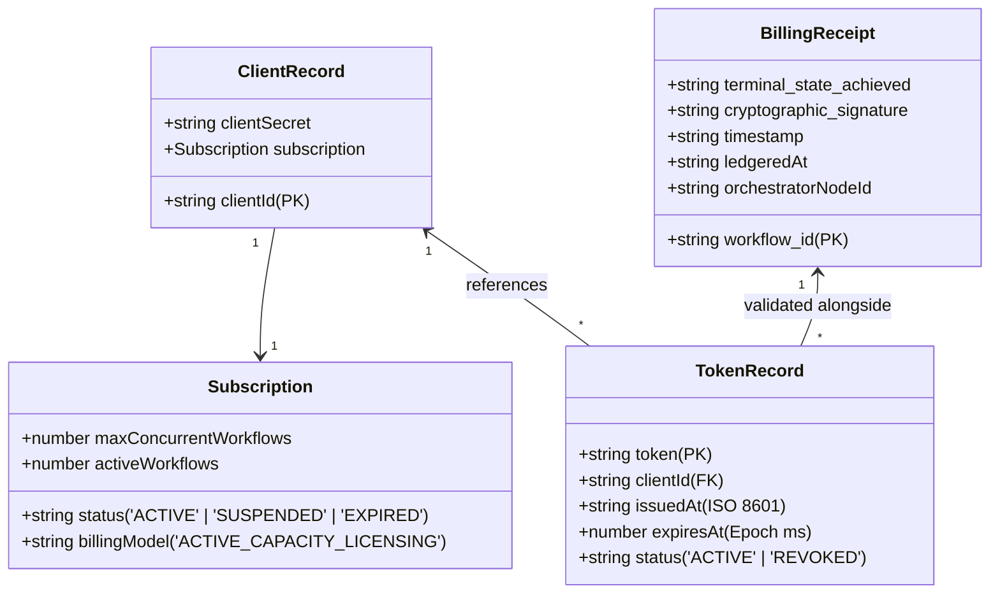
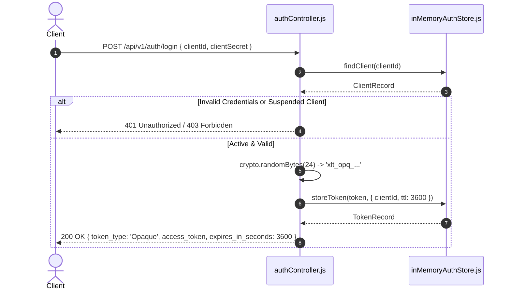
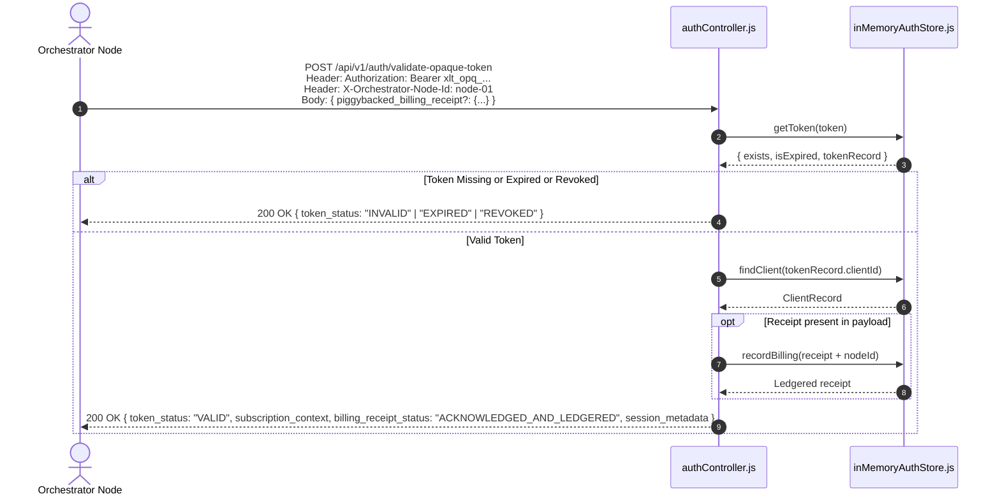

# Auth Service — System Design & Low-Level Architecture (LLD)

This document details the low-level design (LLD), core architectural decisions, trade-offs, and critical interview talking points for the **Auth Service**.

---

## 1. System Overview & Domain Problem

The **Auth Service** is an authoritative identity, subscription, and billing acknowledgment gateway built for multi-tenant enterprise orchestration. It is responsible for:
1. **Corporate Tenant Lifecycle**: Onboarding enterprise clients with subscription licensing (`ACTIVE_CAPACITY_LICENSING`).
2. **High-Entropy Token Issuance**: Issuing opaque bearer tokens with definitive Time-To-Live (TTL).
3. **Authoritative Token Introspection (RFC 7662)**: Providing an inspection endpoint where orchestrator nodes verify token validity, subscription active status, and remaining TTL.
4. **Piggybacked Billing Ledgering**: Amortizing network round-trips by ledgering workflow execution receipts piggybacked directly onto the token verification request.
5. **Instant Administrative Kill Switch**: Immediate global session termination via token revocation.

---

## 2. Low-Level Design (LLD)

### 2.1 Component Architecture

```mermaid
graph TD
    Client[Enterprise Client / Tenant] -->|1. POST /login| AuthController
    Orchestrator[Multi-Bank Orchestrator Node] -->|2. POST /validate-opaque-token + Receipt| AuthController
    Admin[Security Ops] -->|3. POST /revoke| AuthController

    subgraph Auth Service Boundary
        AuthController[authController.js]
        
        subgraph DTO Layer
            ClientDTO[Client Baseline DTO]
            LoginDTO[Login Response DTO]
            IntrospectDTO[Introspection DTO]
        end

        subgraph Storage Layer: inMemoryAuthStore.js
            ClientMap[("clients Map<String, ClientRecord>")]
            TokenMap[("opaqueTokens Map<String, TokenRecord>")]
            BillingMap[("billingLedger Map<String, BillingReceipt>")]
        end

        AuthController --> DTO Layer
        AuthController --> Storage Layer
    end
```

---

### 2.2 In-Memory Data Contracts & Schemas

The storage layer is backed by native JavaScript `Map` collections providing $O(1)$ constant-time operations.



#### Contract Definitions:
- **`clients: Map<String, ClientRecord>`**
  - **Key**: `clientId` (e.g. `'tata_steel'`).
  - **Purpose**: Stores credentials and real-time subscription capacity quotas.
- **`opaqueTokens: Map<String, TokenRecord>`**
  - **Key**: `token` string formatted as `xlt_opq_` + 48-char random hex (`crypto.randomBytes(24)`).
  - **Purpose**: Tracks token lifecycle, owner client ID, and absolute expiration epoch.
- **`billingLedger: Map<String, BillingReceipt>`**
  - **Key**: `workflow_id`.
  - **Purpose**: Immutable append-only audit trail of acknowledged terminal workflow executions.

---

### 2.3 Core Execution Sequence Diagrams

#### Flow A: Client Login & Opaque Token Issuance


#### Flow B: Authoritative Introspection with Piggybacked Billing


---

## 3. Key Design Decisions & Architectural Rationale

### 1. Opaque Tokens vs. Stateless Signed JWTs
- **Decision**: Use **stateful, high-entropy opaque tokens** (`xlt_opq_<48-hex>`) verified against an authoritative store.
- **Why not JWT?**:
  - In high-stakes enterprise financial and multi-bank orchestration, security revocation must be **instantaneous**.
  - A signed JWT is valid until its expiration unless a distributed blacklist is polled—which completely defeats the "stateless" advantage of JWTs.
  - Opaque tokens prevent client-side credential inspection and shield sensitive internal routing metadata from being decoded.

### 2. OAuth2 RFC 7662 Style Token Introspection
- **Decision**: Return HTTP `200 OK` with `{ token_status: "VALID" | "EXPIRED" | "REVOKED" | "INVALID" }` rather than HTTP 401/403.
- **Rationale**:
  - The caller is an internal orchestrator/gateway node, not the end user.
  - The orchestrator needs diagnostic visibility into *why* an authorization check failed (e.g. distinguishing an expired session that requires refresh vs. an emergency security revocation) to execute appropriate fallback logic.

### 3. Piggybacked Billing Receipt Pattern
- **Decision**: Accept an optional `piggybacked_billing_receipt` directly within the token validation request.
- **Rationale**:
  - **Network Amortization**: Eliminates an entire dedicated HTTP round-trip ($N$ workflow validations $+ N$ billing calls $\to N$ total requests).
  - **Guaranteed Ordering**: A node proves it completed workflow $N-1$ by attaching its receipt at the moment it authorizes workflow $N$.

### 4. Active Capacity Licensing Model
- **Decision**: Track `maxConcurrentWorkflows` alongside `activeWorkflows` at the client level.
- **Rationale**:
  - Fits corporate enterprise pricing (clients license execution concurrency rather than simple per-seat users).
  - Allows downstream orchestrators to enforce dynamic backpressure or rate-limiting before dispatching heavy banking API calls.

---

## 4. Trade-Off Analysis

| Dimension | Our Design (Opaque Tokens + Introspection) | Alternative Approach (Stateless JWTs) | Trade-Off Rationale |
| :--- | :--- | :--- | :--- |
| **Revocation Speed** | **Instantaneous ($O(1)$ Map update)** | Delayed until expiration (or requires blacklist) | Critical for banking: compromised sessions must be killed immediately. |
| **Token Payload Size** | **Compact**: ~56 chars (`xlt_opq_...`) | Large: 300–800+ chars (Base64 headers, claims, signature) | Saves ingress bandwidth across millions of requests. |
| **Verification Overhead** | Requires network hop to Auth Service / cache | Verified locally on worker nodes with public key | Opaque tokens trade network calls for absolute security control. |
| **Data Leakage Risk** | **Zero**: Token contains no readable business data | Risk: Claims in JWT payload can be inspected by anyone | Protects corporate identity and subscription tier metadata. |

---

| Billing Approach | Our Design (Piggybacked on Auth) | Alternative: Dedicated Async Queue (Kafka/RabbitMQ) | Trade-Off Rationale |
| :--- | :--- | :--- | :--- |
| **Infrastructure Complexity** | **Minimal**: Reuses existing RPC / HTTP channel | High: Requires broker clusters, dead-letter queues, consumer groups | Perfect for lightweight prototypes and low-footprint services. |
| **Network Roundtrips** | **1 roundtrip for Auth + Billing** | 1 roundtrip for Auth + async produce to Kafka | Avoids multiple network hops per request cycle. |
| **Decoupling** | Auth service assumes secondary role of ledgering | Pure separation of concerns | Acceptable trade-off when billing acknowledgment gates subsequent authorizations. |

---

## 5. Interview Deep-Dive Questions & Answers

### Q1: "Why did you choose an Opaque Token instead of a JWT for a Multi-Bank Orchestration system?"
> **Candidate Answer**:
> *"In a multi-bank orchestrator, financial transactions carry high fraud and compliance liability. If an enterprise tenant's API key is compromised, or their account is suspended for non-payment, we cannot tolerate a 15-minute or 1-hour window where existing tokens remain valid. 
> Signed JWTs are stateless, meaning revocation requires a distributed blacklist—which negates the benefit of statelessness. Opaque tokens act as high-entropy reference pointers; validation always queries the authoritative state in $O(1)$ time, making administrative revocation (our `/revoke` kill switch) globally instantaneous."*

---

### Q2: "How does the Piggybacked Billing Receipt work, and what problem does it solve?"
> **Candidate Answer**:
> *"Downstream orchestrator nodes need to both authenticate incoming requests and report completed workflow billing receipts. Instead of maintaining two separate network calls—one to validate the token and another to report billing—we piggyback the completed receipt on the next token validation call. 
> The Auth Service validates the session and atomically appends the receipt to the `billingLedger`. This cuts network overhead in half and ensures zero billing loss without requiring a distributed message broker in the critical path."*

---

### Q3: "How would you scale this prototype from an in-memory Map to a production deployment handling 500,000 requests/sec?"
> **Candidate Answer**:
> 1. **Distributed Cache (Redis Cluster)**:
>    - Replace the in-memory `opaqueTokens` Map with a distributed **Redis Cluster**.
>    - Use Redis native key expiration (`EXPIRE token 3600`) so expired tokens are automatically evicted by Redis without active GC loops.
> 2. **Client Metadata Caching**:
>    - Client subscription data sits in a persistent database (PostgreSQL / Aurora), cached in Redis with a 5-minute TTL or invalidated via Pub/Sub on client update.
> 3. **Billing Ingestion Pipeline**:
>    - Rather than writing directly to an in-memory ledger, the endpoint pushes the billing receipt into a high-throughput buffer (Redis Stream or Kafka partition) where a billing worker microservice writes batches to an analytical store (ClickHouse / Snowflake).
> 4. **Horizontal Scaling**:
>    - Auth Service instances become completely stateless Node.js containers behind an Application Load Balancer.

---

### Q4: "Why use `crypto.randomBytes(24)` with a prefix like `xlt_opq_`?"
> **Candidate Answer**:
> - **Entropy**: 24 cryptographically secure random bytes yield 48 hex characters ($16^{48} \approx 2^{192}$ combinations), making brute-force guessing mathematically impossible within the universe's lifetime.
> - **Secret Scanning**: Standard prefixes (like `xlt_opq_` or GitHub's `ghp_`) allow automated regex scanners (GitHub Secret Scanner, Datadog) to instantly detect accidentally leaked tokens in code repositories.

---

### Q5: "What is the time complexity of the core operations in this service?"
> **Candidate Answer**:
> - **`findClient(clientId)`**: $O(1)$ HashMap lookup.
> - **`storeToken(token, metadata)`**: $O(1)$ HashMap insertion.
> - **`getToken(token)`**: $O(1)$ HashMap lookup + comparison of timestamp vs `expiresAt`.
> - **`revokeToken(token)`**: $O(1)$ mutation of token status flag.
> - **`recordBilling(receipt)`**: $O(1)$ HashMap insertion into the billing ledger.
> All critical-path operations run in constant $O(1)$ time and zero I/O wait.
