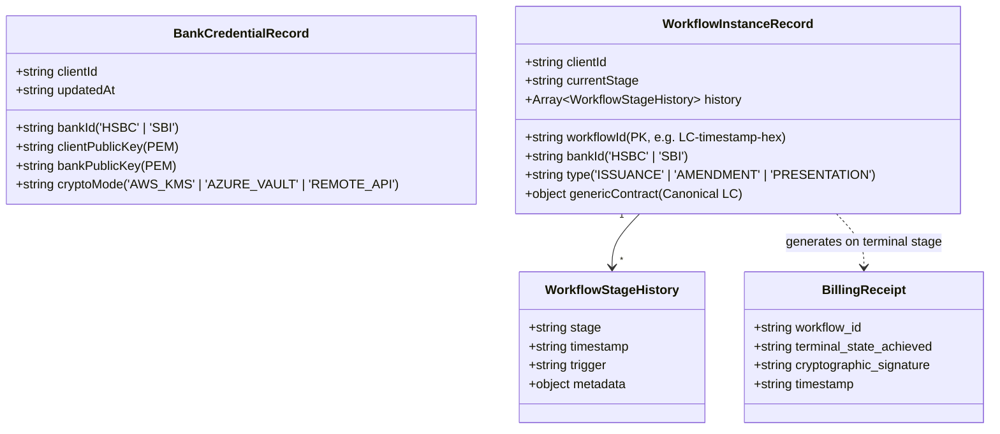
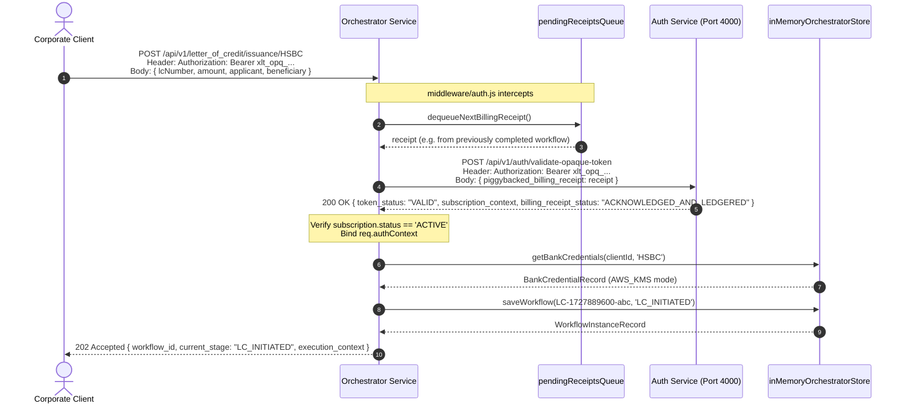
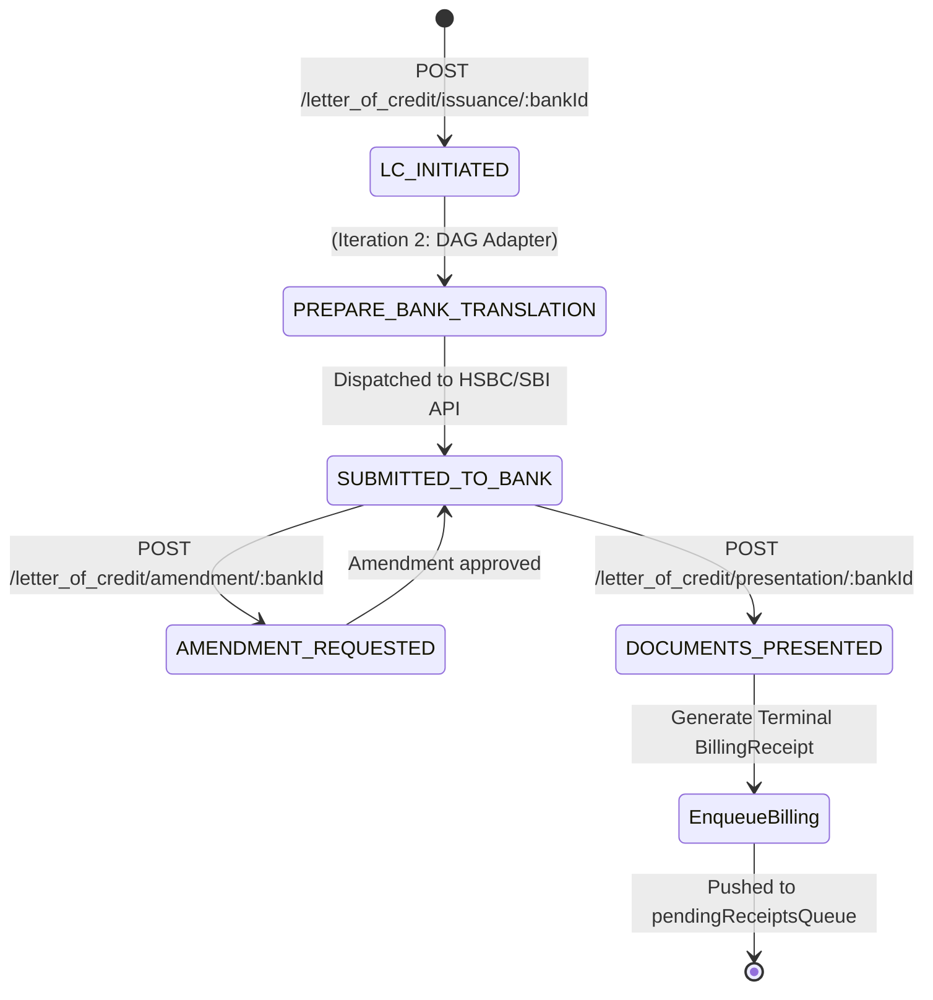

# Orchestrator Service — System Design & Low-Level Architecture (LLD)

> **Iteration 1: Baseline Prototype & Multi-Bank Gateway**  
> *Note*: This iteration establishes the core gateway, the intentional authentication network hop, public key credential management, and the baseline Letter of Credit (LC) state machine. Bank-specific DAG adapter execution and external bank API dispatches are scheduled for Iteration 2.

---

## 1. System Overview & Problem Statement

The **Multi-Bank Orchestrator Service** serves as the mission-critical gateway for corporate enterprises to interact with diverse banking networks (currently integrated with **HSBC** and **SBI**) for Trade Finance operations, specifically **Letters of Credit (LC)**:
- **`LC Issuance`**: Initiating high-value import/export financial credit guarantees.
- **`LC Amendment`**: Requesting modifications to an active LC (terms, amounts, dates).
- **`LC Presentation`**: Presenting trade document manifests (bills of lading, invoices) for bank inspection.

### Core Architectural Responsibilities:
1. **Intentional Network Hop**: Authenticating every inbound request by invoking the authoritative `Auth Service` (`POST /api/v1/auth/validate-opaque-token`), validating real-time corporate subscription capacity.
2. **Piggybacked Billing Drain**: Draining completed workflow receipts and piggybacking them onto outbound authentication calls to amortize network hops.
3. **Non-Custodial Key Architecture**: Storing public keys only (`clientPublicKey`, `bankPublicKey`); strictly forbidding corporate private keys.
4. **Canonical-to-Bank Translation Boundary**: Receiving standard canonical LC payloads from enterprise clients and preparing them for bank-specific DAG execution.

---

## 2. Low-Level Design (LLD)

### 2.1 Component Architecture

```mermaid
graph TD
    Client[Enterprise Client / Corporate ERP] -->|Bearer Token + LC Payload| GatewayRouter[routes/orchestrator.routes.js]

    subgraph Orchestrator Service (Port 3000)
        GatewayRouter --> AuthMiddleware[middleware/auth.js]
        
        AuthMiddleware -->|Drains next pending receipt| QueueBuffer[("pendingReceiptsQueue []")]
        
        AuthMiddleware -->|Route Guards: bankId in HSBC, SBI| GatewayController[controllers/orchestratorController.js]

        subgraph In-Memory Store: inMemoryOrchestratorStore.js
            CredentialsMap[("bankCredentials Map<String, BankCredentialRecord>")]
            WorkflowsMap[("workflows Map<String, WorkflowInstanceRecord>")]
            QueueBuffer
        end

        GatewayController --> CredentialsMap
        GatewayController --> WorkflowsMap
    end

    subgraph Auth Service (Port 4000)
        AuthServiceAPI[POST /validate-opaque-token]
    end

    AuthMiddleware -->|Intentional Network Hop + Piggybacked Receipt| AuthServiceAPI
```

---

### 2.2 In-Memory Data Models & Security Contracts



#### Security Guard Rule:
```javascript
// Strict Non-Custodial Constraint in inMemoryOrchestratorStore.js
if (record.privateKey || record.secretKey || record.clientPrivateKey) {
  throw new Error('SECURITY VIOLATION: Private keys must never be stored in the orchestrator.');
}
```

---

### 2.3 Core Execution Flow & Sequence Diagrams

#### Sequence 1: Inbound Request with the Intentional Auth Hop & Piggybacked Billing


#### Sequence 2: Letter of Credit State Machine (Lifecycle)


---

## 3. Key Design Decisions & Architectural Rationale

### 1. Why an Intentional Network Hop on Every Request?
- **Interview Question**: *"Why call Auth Service on every orchestrator request instead of validating a local JWT or caching for 10 minutes?"*
- **Rationale**:
  - **Dynamic Capacity Quotas**: In enterprise corporate banking, licenses are based on `ACTIVE_CAPACITY_LICENSING` (e.g. max 50 concurrent workflows). Caching token validation locally would cause orchestrator nodes to be blind to real-time cluster-wide workflow concurrency.
  - **Zero Revocation Window**: High-value transactions (e.g., $10M Letter of Credit) cannot tolerate a stale token cache. If a corporate credential is revoked or suspended, execution must halt immediately.

### 2. Non-Custodial Key Storage & Asymmetric Crypto Delegation
- **Interview Question**: *"How do we encrypt and sign bank payloads without storing the corporate private key?"*
- **Rationale**:
  - The orchestrator maintains **zero custody** of corporate private keys. Storing corporate private keys introduces astronomical security, SOC-2, and financial compliance liability.
  - The orchestrator holds:
    1. **`clientPublicKey`**: Used to verify client payload signatures.
    2. **`bankPublicKey`**: Used to encrypt payloads sent to HSBC/SBI.
  - When the client's private key is required for signing, the orchestrator invokes the client's dedicated **`cryptoMode`** (`AWS_KMS`, `AZURE_VAULT`, or a callback to the client's corporate HSM).

### 3. Canonical LC Model vs. Bank-Specific Payload
- **Rationale**:
  - HSBC uses ISO 20022 XML (`pain.001`, `camt.053`) and Swift MT700 formats.
  - SBI uses customized JSON APIs and proprietary trade finance schemas.
  - Exposing bank-specific formats to corporate clients creates tight coupling. The orchestrator exposes a **canonical JSON contract** and delegates format translation to bank-specific DAG adapters in Iteration 2.

### 4. Asynchronous 202 Accepted Workflow Pattern
- **Rationale**:
  - Bank APIs for Trade Finance are not synchronous; establishing an LC with a bank involves multi-day approval cycles, SWIFT network transmission, and bank advisory checks.
  - Returning `202 Accepted` immediately gives the client a durable `workflow_id` to poll or receive webhooks against, preventing HTTP connection timeouts.

---

## 4. Trade-Off Analysis

| Dimension | Our Choice | Alternative | Trade-Off Rationale |
| :--- | :--- | :--- | :--- |
| **Auth Verification** | **Intentional Network Hop** | Local JWT signature verification | Trades a ~5ms local network hop for immediate revocation and accurate cluster-wide capacity licensing. |
| **Key Custody** | **Non-Custodial (Public keys only)** | Custodial (Storing corporate private keys) | Avoids immense liability and compliance audit scope; offloads signing to corporate KMS. |
| **Billing Delivery** | **Piggybacked on Auth Hop** | Dedicated Kafka / RabbitMQ producer | Zero extra network hops; piggybacking drains completed receipts synchronously with the next inbound token validation. |
| **Bank Selection** | **Strict Route Param Guard (`HSBC`, `SBI`)** | Dynamic plugin registry | Keeps routing deterministic, auditable, and simple for interview recall in Iteration 1. |

---

## 5. Interview Deep-Dive Q&A

### Q1: "Why do you have an intentional network hop between Orchestrator and Auth Service?"
> **Candidate Answer**:
> *"In corporate multi-bank orchestration, we deal with multi-million dollar Letters of Credit. We cannot rely on stateless JWTs because a suspended account or revoked session must be enforced immediately. 
> Furthermore, our subscription model is `ACTIVE_CAPACITY_LICENSING`—we license concurrent active workflows. Calling the Auth Service gives us the authoritative, real-time subscription context before we spin up heavy banking workflows."*

---

### Q2: "How does the orchestrator prevent storing corporate private keys?"
> **Candidate Answer**:
> *"Our storage layer strictly enforces a non-custodial boundary: any payload containing `privateKey` or `secretKey` is rejected with a `400 Bad Request`.
> We only store the client's public key (to verify incoming client signatures) and the bank's public key (to encrypt outbound bank dispatches). If payload signing is required, we use the client's configured `cryptoMode`—such as AWS KMS, Azure Key Vault, or an external corporate HSM endpoint—ensuring the private key never leaves the client's secure perimeter."*

---

### Q3: "Explain how the Piggybacked Billing Receipt queue works across the two services."
> **Candidate Answer**:
> *"When a workflow reaches a terminal state (like `DOCUMENTS_PRESENTED`), the orchestrator generates a cryptographically signed `BillingReceipt` and enqueues it in `pendingReceiptsQueue`.
> On the very next inbound API call, our `middleware/auth.js` intercepts the request, dequeues the pending receipt, and attaches it as `piggybacked_billing_receipt` in the body of the authentication network hop to Port 4000. 
> The Auth Service validates the token and atomically ledgers the billing receipt in a single round-trip, completely eliminating the need for an independent billing network call."*

---

### Q4: "What happens in Iteration 2 when an LC Issuance is accepted?"
> **Candidate Answer**:
> *"In Iteration 1, `POST /letter_of_credit/issuance/:bankId` initializes the workflow state to `LC_INITIATED` and returns `202 Accepted` with an execution context. 
> In Iteration 2, a worker picks up this context, translates the canonical LC into the target bank's proprietary format (e.g., SWIFT MT700 for HSBC or REST JSON for SBI), calls the client's KMS for cryptographic signing, and dispatches the payload to the bank's trade gateway."*
