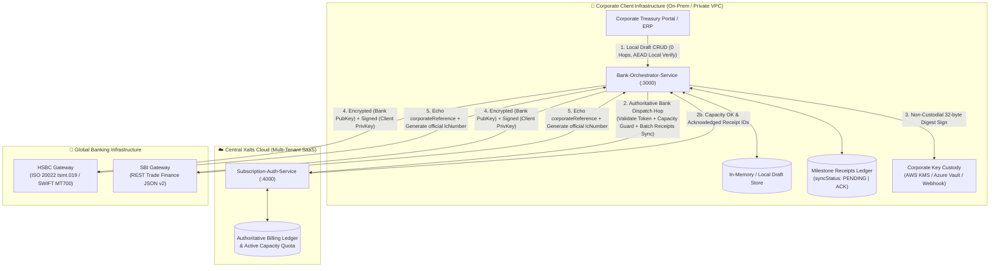
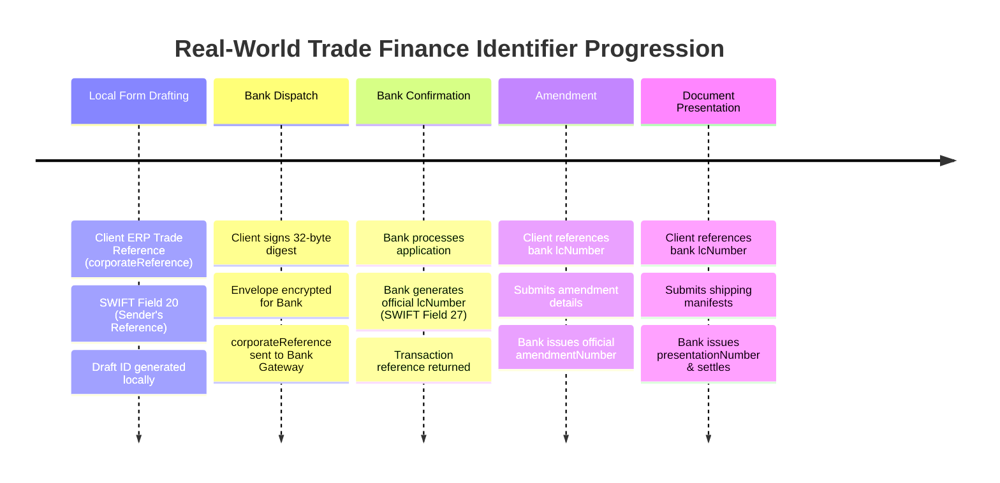
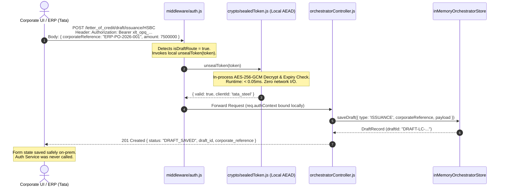
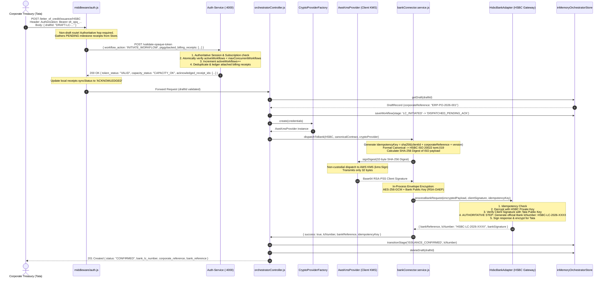
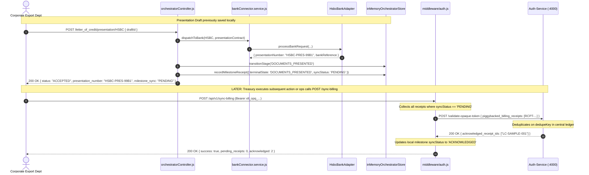

# Multi-Bank Orchestrator — System Design & Engineering Architecture (Iteration 3)
## Production-Grade Dual-Perimeter Gateway, Sealed AEAD Tokens, Offline Local Drafting & Real-World Banking Identifiers

---

## Executive Summary & System Vision

Global trade finance ($10T+ annually) relies on Letters of Credit (LCs) governed by the International Chamber of Commerce (ICC UCP 600 rules). When multinational corporate enterprises (e.g., Tata Steel, Reliance Industries, Anglo American) initiate trade transactions, they face three uncompromising engineering challenges:

1. **Sovereign Data Residency & Compliance (GDPR / Indian DPDP / SWIFT CSP)**: Corporate treasuries forbid uploading proprietary trade contracts, bills of lading, supplier pricing schedules, and counterparty metadata into a multi-tenant SaaS cloud.
2. **Zero Private Key Custody & Key Governance**: Banks require cryptographic signing using corporate private keys. Enterprise compliance forbids handing private keys to third-party software vendors.
3. **Session Availability & Resilience (The "Coffee Spill" Failure Mode)**: Drafting a commercial Letter of Credit requires filling dozens of shipping lines, customs tariffs, inspection clauses, and multi-bank routing codes. If the network link to the centralized SaaS vendor drops or the session expires, the operator must never lose their draft.

**Iteration 3 transforms the architecture into a production-grade Dual-Perimeter System**:
- **Perimeter A (Local Client Infrastructure)**: Deployed on-prem or in the client's private VPC (Kubernetes). Houses the UI, Draft Engine, and Orchestrator. Draft operations run **100% locally with 0 central network hops**, authenticated statelessly via **Sealed AEAD Opaque Tokens** (`AES-256-GCM`).
- **Perimeter B (Centralized Xalts SaaS Cloud)**: Houses the central **Subscription-Auth-Service** and deduplicated **Billing Ledger**. Authoritative session checks, active concurrent capacity licensing (`activeWorkflows < maxConcurrentWorkflows`), and milestone billing sync happen here **only upon bank dispatch**.
- **Real-World Banking Identifiers**: Eliminates naive middleware-generated LC numbers. Clients provide internal ERP references (`corporateReference` — SWIFT Field 20: *Sender's Reference*); global banks (HSBC / SBI) generate the official `lcNumber` (SWIFT Field 27: *Receiver's Reference*), `amendmentNumber`, and `presentationNumber`.
- **Milestone Ledger Synchronization**: Completely eliminates background flusher workers and ephemeral queue arrays. Milestone receipts are stored with `syncStatus: 'PENDING' | 'ACKNOWLEDGED'` and batch-synchronized on outbound authoritative calls or via on-demand triggers (`/sync-billing`).

---

## 1. High-Level Design (HLD)

### 1.1 Dual-Perimeter Hybrid Topology



---

### 1.2 Real-World Banking Identifier Progression

In international trade finance, neither the client nor the middleware creates the official `lcNumber`. The official lifecycle maps directly into international messaging protocols:



| Lifecycle Phase | Who Generates Key? | Technical Identifier | Standard Banking Protocol Mapping |
| :--- | :--- | :--- | :--- |
| **Drafting** | Corporate ERP | `corporateReference` (e.g., `ERP-PO-2026-9901`) | SWIFT MT700 Field 20 (*Sender's Reference*) |
| **Draft Storage** | Orchestrator Local | `draftId` (e.g., `DRAFT-LC-1727889600000-a1b2c3`) | Internal form state pointer (uncommitted) |
| **Issuance Dispatch**| Global Bank | `lcNumber` (e.g., `HSBC-LC-2026-0049`) | SWIFT MT700 Field 27 (*Receiver's Reference*) |
| **Bank Transaction** | Global Bank | `bankReference` (e.g., `HSBC-TXN-1727889600000`) | Banking gateway clearing reference |
| **Amendment** | Global Bank | `amendmentNumber` (e.g., `HSBC-AMD-88A2`) | SWIFT MT707 Field 26E (*Amendment Number*) |
| **Presentation** | Global Bank | `presentationNumber` (e.g., `HSBC-PRES-99B1`)| ICC UCP 600 Article 14 Presentation Tracking |

---

## 2. Low-Level Design (LLD)

### 2.1 Component Architecture & Package Topology

```mermaid
graph TD
    subgraph Service1 ["🔐 Auth-Subscription-Service (Port 4000)"]
        AuthController["controllers/authController.js"]
        AuthStore["storage/inMemoryAuthStore.js"]
        AuthSealer["crypto/sealedToken.js"]
        
        ClientsTable[("Map: clients<br/>[clientId, ClientRecord]")]
        TokensTable[("Map: opaqueTokens<br/>[token, TokenRecord]")]
        LedgerTable[("Map: billingLedger<br/>[dedupeKey, BillingReceipt]")]
        
        AuthController --> AuthStore
        AuthController --> AuthSealer
        AuthStore --> ClientsTable
        AuthStore --> TokensTable
        AuthStore --> LedgerTable
    end

    subgraph Service2 ["🏦 Bank-Orchestrator-Service (Port 3000)"]
        OrchRouter["routes/orchestrator.routes.js"]
        DualAuthMiddleware["middleware/auth.js"]
        OrchController["controllers/orchestratorController.js"]
        OrchStore["storage/inMemoryOrchestratorStore.js"]
        OrchSealer["crypto/sealedToken.js"]
        
        subgraph CryptoModule ["crypto/"]
            ProviderFactory["cryptoProviderFactory.js"]
            ProviderInterface["cryptoProvider.interface.js"]
            AwsKms["providers/awsKmsProvider.js"]
            AzureVault["providers/azureVaultProvider.js"]
            RemoteApi["providers/remoteWebhookProvider.js"]
            LocalMock["providers/localMockProvider.js"]
            
            ProviderFactory --> ProviderInterface
            ProviderInterface <|-- AwsKms
            ProviderInterface <|-- AzureVault
            ProviderInterface <|-- RemoteApi
            ProviderInterface <|-- LocalMock
        end

        subgraph BankModule ["services/"]
            ConnectorService["bankConnector.service.js"]
            HsbcAdapter["bankAdapters/hsbcAdapter.js"]
            SbiAdapter["bankAdapters/sbiAdapter.js"]
            
            ConnectorService --> HsbcAdapter
            ConnectorService --> SbiAdapter
        end

        OrchRouter --> DualAuthMiddleware
        DualAuthMiddleware -->|Draft Routes: Local AES-GCM Decrypt| OrchSealer
        DualAuthMiddleware -->|Dispatch Routes: POST /validate-opaque-token| AuthController
        DualAuthMiddleware --> OrchController
        OrchController --> ProviderFactory
        OrchController --> ConnectorService
        OrchController --> OrchStore
    end
```

---

### 2.2 Data Models & In-Memory Entity Schemas

#### 1. Sealed AEAD Opaque Token Specification (`crypto/sealedToken.js`)

The token issued to the browser has the prefix `xlt_opq_` followed by an **Authenticated Encryption with Associated Data (AEAD)** envelope:

$$\text{Token} = \text{"xlt\_opq\_"} + \text{Base64URL}(IV) + \text{"."} + \text{Base64URL}(\text{Ciphertext}) + \text{"."} + \text{Base64URL}(\text{AuthTag})$$

- **Algorithm**: `AES-256-GCM` (Galois/Counter Mode).
- **Key**: 256-bit symmetric key (`TOKEN_ENCRYPTION_KEY`) shared across the cluster.
- **IV**: 96-bit (12 bytes) cryptographically random nonce generated per token (`crypto.randomBytes(12)`).
- **Plaintext Payload**:
  ```json
  {
    "clientId": "tata_steel",
    "userId": "service_operator",
    "iat": 1727889600000,
    "exp": 1727893200000,
    "entropy": "4f8a9b2c1d0e3f7a"
  }
  ```
- **AuthTag**: 128-bit (16 bytes) GCM MAC tag ensuring cryptographic tamper resistance.

```typescript
interface UnsealedTokenResult {
  valid: boolean;
  clientId?: string;
  userId?: string;
  issuedAt?: number;
  expiresAt?: number;
  error?: 'INVALID_PREFIX' | 'MALFORMED_ENVELOPE' | 'EXPIRED' | 'CIPHER_TAMPERED';
}
```

#### 2. Orchestrator Storage Entities (`orchestrator-service/src/storage/inMemoryOrchestratorStore.js`)

```typescript
interface DraftRecord {
  draftId: string;               // PK: e.g., 'DRAFT-LC-1727889600000-a1b2c3'
  clientId: string;              // e.g., 'tata_steel'
  bankId: 'HSBC' | 'SBI';
  type: 'ISSUANCE' | 'AMENDMENT' | 'PRESENTATION';
  corporateReference: string;    // Client's ERP Trade/PO Reference
  lcNumber?: string;             // Attached for Amendment/Presentation drafts
  stage: 'DRAFT';
  payload: Record<string, any>;  // Canonical contract form state
  createdAt: string;
  updatedAt: string;
}

interface WorkflowInstanceRecord {
  workflowId: string;            // PK: Internal UUID/timestamp
  clientId: string;
  bankId: 'HSBC' | 'SBI';
  type: 'ISSUANCE' | 'AMENDMENT' | 'PRESENTATION';
  corporateReference: string;    // SWIFT Field 20
  lcNumber: string | null;       // SWIFT Field 27 (Bank-assigned on issuance)
  amendmentNumber?: string;      // Bank-assigned on amendment
  presentationNumber?: string;   // Bank-assigned on presentation
  currentStage: 'LC_INITIATED' | 'DISPATCHED_PENDING_ACK' | 'ISSUANCE_CONFIRMED' | 'AMENDMENT_CONFIRMED' | 'DOCUMENTS_PRESENTED';
  genericContract: Record<string, any>;
  history: Array<{
    stage: string;
    timestamp: string;
    trigger: string;
    metadata?: Record<string, any>;
  }>;
  createdAt: string;
  updatedAt: string;
}

interface MilestoneReceiptRecord {
  receiptId: string;             // PK: 'RCPT-1727889600000-a1b2c3'
  workflow_id: string;           // Foreign reference
  corporate_reference: string;
  terminal_state_achieved: string;// e.g., 'DOCUMENTS_PRESENTED'
  cryptographic_signature: string;// RSA-PSS signature
  timestamp: string;             // ISO 8601
  syncStatus: 'PENDING' | 'ACKNOWLEDGED';
  acknowledgedAt?: string;
}
```

---

### 2.3 End-to-End Sequence Diagrams

#### Sequence 1: Offline Local Draft Creation (Zero Central Network Hops)



---

#### Sequence 2: Strict Two-Step Bank Dispatch with Bank-Assigned LC Number



---

#### Sequence 3: Document Presentation & Batch Milestone Synchronization



---

## 3. Major Engineering Decisions & Technical Rationales

### Decision 1: Sealed AEAD Opaque Tokens over Stateless JWTs and Distributed Redis

- **Context**: We need to authenticate client operations across both multi-tenant SaaS (multiple container replicas behind a load balancer) and single-tenant on-prem client datacenters without maintaining separate codebases.
- **Options Evaluated**:
  1. *Stateless Plain JWT*: Exposes tenant scopes, account IDs, and pricing tiers to browser DevTools and corporate proxies (violates Zero Claim Leakage).
  2. *Pure Random Opaque Token with Distributed Redis*: Requires standing up a Redis cluster on-prem, introducing operational complexity, failure modes, and connection pooling overhead for simple draft operations.
  3. *Sealed AEAD Opaque Token (`AES-256-GCM`)*: Auth Service seals `{ clientId, exp, iat }` into an encrypted envelope prefixed with `xlt_opq_`.
- **Decision**: Adopt Sealed AEAD Opaque Tokens.
- **Why It Matters**:
  - **Zero Claim Leakage**: To the browser and proxy logs, the token looks completely opaque. It cannot be decoded or inspected.
  - **Stateless Local Verification (< 0.05ms)**: Any Orchestrator replica (in SaaS or on-prem) decrypts the token locally for draft CRUD operations.
  - **Unified Codebase**: Runs identically in SaaS and on-prem with zero code divergences.

---

### Decision 2: Dual-Perimeter Routing (Offline Local Drafts vs Centralized Bank Dispatches)

- **Context**: In international trade, drafting an LC takes 15–45 minutes of detailed commercial data entry. If the network link to Xalts cloud drops or the central Auth Service undergoes routine maintenance, an enterprise user cannot be blocked from saving form drafts.
- **Decision**: Split routing into two cryptographic perimeters:
  - **Local Perimeter (`/letter_of_credit/draft/*`)**: Authenticated in-process using `unsealToken()`. Consumes 0 network hops, 0 capacity licensing quota, and persists form drafts safely on-prem.
  - **Authoritative Dispatch Perimeter (`/letter_of_credit/issuance/*`, etc.)**: Makes the authoritative network hop to Auth Service to validate active subscriptions, increment concurrent workflow counters, and batch-sync billing receipts before calling the bank.
- **Why It Matters**: Eliminates form data loss, isolates central SaaS outages from on-prem business continuity, and avoids premature quota consumption on uncommitted transactions.

---

### Decision 3: Real-World Banking Identifiers (Client Field 20 vs Bank Field 27)

- **Context**: Naive mock architectures generate the `lcNumber` inside the middleware or let the corporate client invent it. In real-world SWIFT/ISO 20022 standards, only the issuing bank has legal authority to assign the Letter of Credit Number.
- **Decision**:
  - Client provides their internal ERP reference (`corporateReference` $\to$ SWIFT Field 20: *Sender's Reference*).
  - The issuing bank (HSBC / SBI) generates and confirms the official `lcNumber` (SWIFT Field 27: *Receiver's Reference*).
  - Amendments and presentations anchor to the bank-assigned `lcNumber`, and the bank generates official `amendmentNumber` and `presentationNumber`.
- **Why It Matters**: Prevents contract invalidation at global banking clearinghouses, enables automated reconciliation between corporate ERP systems (SAP S/4HANA) and SWIFT FIN MT700 confirmations, and eliminates numbering collisions.

---

### Decision 4: In-Memory Milestone Ledger with Batch Sync over Background Flusher Workers

- **Context**: In Iteration 2, an independent background worker (`idleReceiptFlusher.js`) executed a `setInterval` timer every 30 seconds to flush receipts using platform-level M2M secret credentials.
- **Security & Reliability Flaws in Iteration 2**:
  1. Storing platform-level M2M secrets inside on-prem client containers introduces credential theft risks (if a client attacker extracts the secret, they can call Auth Service with forged data).
  2. Unmanaged Node.js timers (`setInterval`) risk event-loop leaks and race conditions with in-flight HTTP requests.
- **Decision**: Completely retire the background worker and replace the ephemeral queue with a **Milestone Ledger**:
  - Milestone receipts are recorded with `syncStatus: 'PENDING'`.
  - Normal outbound authoritative calls batch-flush all pending receipts.
  - Provide an on-demand endpoint `POST /api/v1/sync-billing` authenticated by the client's own session token for low-volume or end-of-billing-cycle flushes.
- **Why It Matters**: Eliminates platform secrets from client infrastructure, eliminates background timer leaks, guarantees deterministic at-least-once synchronization, and simplifies container operational lifecycle.

---

### Decision 5: Non-Custodial Cryptographic Partitioning & Digest-Only Signing

- **Context**: Communicating with global banking gateways requires 4 distinct asymmetric cryptographic operations:
  1. Sign payload with Client's Private Key.
  2. Encrypt payload with Bank's Public Key.
  3. Decrypt response with Client's Private Key.
  4. Verify bank signature with Bank's Public Key.
- **Decision**: Partition operations strictly by trust boundary:
  - **In-Process Compute (Public Key Operations)**: Bank Public Key Hybrid Envelope Encryption (`AES-256-GCM` + RSA-OAEP) and Bank Signature Verification execute in-process using native OpenSSL bindings (< 0.5ms, $0 cloud costs).
  - **Delegated Compute (Private Key Operations)**: Client Private Key Signing and Response Decryption delegate to the client's cloud KMS, HSM, or Webhook.
  - **Digest-Only Transmission (`MessageType: DIGEST`)**: Orchestrator hashes the document locally (`SHA-256`) and transmits only the 32-byte digest to AWS KMS or the client webhook.
- **Why It Matters**: Reduces KMS network payloads by 99%, bypasses AWS KMS 4KB payload limits, eliminates KMS egress costs, and completely absolves Xalts from corporate private key liability.

---

## 4. Engineering & Product Trade-offs

### Trade-off 1: Sealed AEAD Opaque Token vs Distributed Redis Cluster vs Stateless RS256 JWT

| Architecture Metric | Stateless RS256 JWT | Pure Opaque Token + Redis Cluster | Sealed AEAD Opaque Token (Implemented) |
| :--- | :--- | :--- | :--- |
| **Claim Leakage to Browser / Proxy** | **High Failure**: Base64 decodable via `jwt.io` or proxy logs | **Zero Leakage**: Pure random string | **Zero Leakage**: Encrypted AES-256-GCM ciphertext |
| **Local Draft Verification Latency** | < 0.1ms (Public key verify) | 2–5ms (Network call to Redis) | **< 0.05ms** (In-process AES-GCM decrypt) |
| **On-Prem Infrastructure Footprint**| Low (0 external dependencies) | **High**: Requires deploying, patching & monitoring Redis | **Low**: 0 external dependencies (Single container) |
| **Multi-Replica SaaS Compatibility**| High (Stateless) | High (Shared Redis state) | **High** (Shared cluster symmetric key) |
| **Instant Kill-Switch Revocation** | Difficult (Requires distributed blocklist)| Instantaneous (Delete key in Redis) | **Instantaneous at Bank Dispatch** (Authoritative check at Auth Service) |

---

### Trade-off 2: Strict Two-Step Pipeline (Draft Required) vs Single-Shot Direct Dispatch

| Dimension | Single-Shot Direct Dispatch | Strict Two-Step Pipeline (Implemented) |
| :--- | :--- | :--- |
| **Operator Error Prevention** | **Poor**: Single click immediately executes $10M banking obligation | **Superior**: Operator creates, reviews, and modifies draft before committing |
| **Network Failure Resilience** | If connection drops during payload upload, all form data is lost | Form state safely persisted in draft store; operator resumes without re-entry |
| **Capacity Quota Timing** | Increments quota immediately, even if operator cancels | Quota increment deferred until final bank dispatch |
| **API Complexity** | 1 endpoint per lifecycle stage | 2 endpoints per stage (`/draft/*` and dispatch) |

---

### Trade-off 3: Piggybacked Milestone Ledger Sync vs Immediate Synchronous Push vs Background Worker

| Trade-off Dimension | Immediate Synchronous Push | Background Interval Worker (Iteration 2) | Milestone Ledger Batch Sync (Implemented) |
| :--- | :--- | :--- | :--- |
| **Network Hop Overhead** | Adds +1 network call to every terminal state transition | Periodic interval calls regardless of activity | **0 Extra Network Hops**: Piggybacks on regular auth hops |
| **Credential Security** | Uses user's active session token | **Vulnerable**: Required platform M2M secret on-prem | **Secure**: Uses active session token or /sync-billing |
| **Failure Domain** | If Auth Service is down, terminal presentation fails | Timer fails silently in background | Milestone stored with `syncStatus: PENDING`; automatically retries on next hop |
| **Container Clean Shutdown**| Clean | Requires clearing interval timer (`unref()`) | **Clean**: 0 background timers or event loop locks |

---

## 5. Interview Playbook: What to Focus on & How to Stand Out

When interviewing for Staff+, Lead Architect, or Principal Engineer roles, framing is everything. Use this battle-tested playbook:

### 1. The 3-Minute Architectural Elevator Pitch
> *"In enterprise trade finance, you cannot build a standard B2B SaaS CRUD app. We were tasked with designing a multi-bank orchestrator connecting corporate giants like Tata Steel to global banks like HSBC and SBI.*
> 
> *We faced three hard constraints: first, clients refuse to upload trade contracts into multi-tenant SaaS clouds due to data residency compliance; second, private keys must never leave corporate HSMs; and third, trade finance drafting takes 30 minutes, so WAN drops to the central cloud must not kill form state.*
> 
> *Our breakthrough was a **Dual-Perimeter Architecture**: on-prem, the Orchestrator handles offline local draft saving with zero central network hops, authenticated statelessly via **Sealed AEAD Opaque Tokens** (`AES-256-GCM`). Centralized Xalts SaaS cloud is only invoked upon authoritative bank dispatch to enforce active concurrent capacity licensing. Cryptographically, we partition compute: public key envelope encryption runs in-process with OpenSSL bindings (< 0.5ms), while private key signing transmits only 32-byte digests to client KMS. Finally, we model real-world banking realism: clients supply ERP corporate references (Field 20), and banks issue official LC numbers (Field 27)."*

---

### 2. The 4 Non-Negotiable Pillars to Emphasize

1. **Zero Claim Leakage with Sealed Tokens**: Explain how AES-256-GCM gives you the stateless speed of JWTs without leaking internal licensing tiers, account numbers, or scopes to browser inspectors or corporate TLS proxies.
2. **Non-Custodial Cryptographic Boundary**: Explain why the orchestrator explicitly rejects private keys (`400 security_violation`) and hashes documents locally, transmitting only 32 bytes (`MessageType: DIGEST`) to AWS KMS.
3. **Financial State Machine & Deterministic Idempotency**: Explain how `sha256(clientId + corporateReference + version)` prevents duplicate $10M LC issuances when TCP connections drop.
4. **Milestone Ledger Batch Synchronization**: Explain why eliminating background workers and M2M shared secrets hardened security and simplified operations.

---

## 6. Principal Engineer & Bar Raiser Interview Questions

### Q1: *"If the token is encrypted with AES-256-GCM, how do you handle instantaneous revocation across 20 on-prem orchestrator instances?"*
**Answer**:
> *"We use a two-tier trust model. For low-stakes operations (saving form drafts on-prem), local AEAD unsealing allows high-throughput, offline-resilient drafting. But for high-stakes financial operations—namely dispatching a Letter of Credit to HSBC or SBI—the Orchestrator is required by architecture to make an intentional network hop to the central Auth Service (`/api/v1/auth/validate-opaque-token`).
> 
> If an employee is fired or a corporate account is suspended, the administrator flips the status in Auth Service to `REVOKED`. The very next time the compromised user attempts to dispatch an LC, the central inspection returns `401 REVOKED`, and the transaction is aborted within zero milliseconds. Revocation is instantaneous where financial risk actually lives."*

---

### Q2: *"Why didn't you just use standard distributed transactions (2PC / Sagas) across the Orchestrator, Auth Service, and Banks?"*
**Answer**:
> *"Two-Phase Commit (2PC) is an anti-pattern in cross-organizational enterprise architectures. Global banking networks (SWIFT, HSBC ISO 20022) are external autonomous systems that do not participate in XA transactions or expose prepare/commit phases. Furthermore, 2PC holds database locks across WAN links, creating extreme vulnerability to network partitions.
> 
> Instead, we implement a **Deterministic Idempotency Key Pipeline with a Two-Step State Machine**:
> 1. We compute `idempotencyKey = sha256(clientId + corporateReference + version)`.
> 2. The workflow transitions to `DISPATCHED_PENDING_ACK` before touching the network.
> 3. If a network timeout or crash occurs, a retry by the client or reconciliation engine carries the exact same idempotency key. HSBC's gateway detects the duplicate key and returns the previously processed transaction confirmation without duplicate financial booking."*

---

### Q3: *"What happens if an on-prem Orchestrator container crashes during an active LC dispatch? Is state corrupted?"*
**Answer**:
> *"We designed the state machine specifically around container crash domains. The workflow transitions from `LC_INITIATED` to `DISPATCHED_PENDING_ACK` before any socket is opened to HSBC.
> 
> If the container process is killed mid-flight, upon restart the workflow remains in `DISPATCHED_PENDING_ACK`. When the operator or automated recovery agent retries the dispatch, the Orchestrator computes the identical idempotency key (`sha256(clientId + corporateReference + version)`). When dispatched to HSBC, if HSBC never received the initial packet, it processes it fresh. If HSBC already processed it, HSBC detects the replay, returns the existing bank confirmation (`HSBC-TXN-...`), and the Orchestrator transitions cleanly to `ISSUANCE_CONFIRMED`. No duplicate LC is ever created."*

---

### Q4: *"Why did you eliminate the background idle flusher worker in Iteration 3? What if a client presents documents and shuts down their systems for the weekend?"*
**Answer**:
> *"In Iteration 2, running an automated `setInterval` worker required provisioning platform-level M2M secret credentials inside on-prem client containers. If an attacker on the client side compromised the on-prem container, they could extract those platform secrets and inject fake billing receipts into our central Auth Service.
> 
> In Iteration 3, we eliminated this attack surface entirely. Milestone receipts are stored in the local Milestone Ledger with `syncStatus: 'PENDING'`. They are batch-synchronized on the next outbound call. For the edge case where client volume drops to zero near billing cycle close, we expose an on-demand endpoint `POST /api/v1/sync-billing`. This endpoint is authenticated using the client's own session token—eliminating the need for any static platform secrets on-prem."*

---

### Q5: *"How does this architecture satisfy European GDPR (Article 28/29) and Cross-Border Data Residency regulations?"*
**Answer**:
> *"Under GDPR and sovereign data residency laws, corporate financial documents containing supplier names, commercial trade terms, and cargo details constitute proprietary corporate data. In our Hybrid Perimeter Topology, the Orchestrator and Draft Store live inside the corporate client's sovereign boundary (on-prem or regional VPC).
> 
> The only data that crosses the corporate boundary to the centralized Xalts cloud are:
> 1. Random opaque tokens (`xlt_opq_...`).
> 2. Cryptographic milestone signatures and workflow UUIDs for billing deduplication.
> 
> Proprietary commercial contracts and trade terms never leave the client's infrastructure until they are encrypted directly with the receiving bank's public key (RSA-OAEP) and dispatched directly to the bank. Xalts never sees, stores, or processes unencrypted commercial trade data."*

---

### Q6: *"If an attacker gains root access to the on-prem Orchestrator container, what can they steal and what can they NOT steal?"*
**Answer**:
> *"**What they CANNOT steal**:
> 1. Corporate Private Keys: The Orchestrator has a non-custodial boundary (`saveBankCredentials` throws an exception if any private key is present). Private keys exist exclusively inside the client's AWS KMS, Azure Key Vault, or physical HSM.
> 2. Central SaaS Admin Rights: The container has zero platform-level secrets or admin credentials for the central Auth Service.
> 3. Other Tenants' Data: The container is strictly single-tenant in on-prem deployments and has zero connectivity to peer clients.
> 
> **What they CAN access**:
> - Locally stored in-flight drafts and workflow history for that specific enterprise.
> - The bank's public key certificate.
> 
> Even with full container compromise, the attacker cannot forge signatures on bank contracts because signing requires IAM credentials to the client's isolated cloud KMS."*

---

### Q7: *"How would you evolve this system to handle 100x scale (10,000 transactions/second across 50 banks)?"*
**Answer**:
> *"To scale this architecture to sovereign Tier-1 banking volume:
> 1. **Durable Saga Orchestration with Temporal / Zeebe**: Replace in-memory state tracking with event-driven Temporal workflows. Trade finance involves multi-day human approval steps (customs inspections, port of entry sign-offs). Temporal provides durable execution with crash-resilient multi-day timers and compensation sagas.
> 2. **Confidential Computing via AWS Nitro Enclaves**: For ultra-secure banking, run the in-process envelope encryption inside an isolated Nitro Enclave with CPU and memory cryptographic attestation.
> 3. **Hierarchical Token Bucket Rate Limiting (Redis + Lua)**: Implement multi-tier rate limiting across corporate tenants, bank channels (HSBC SWIFT FIN bandwidth limits), and individual operators to protect downstream bank gateways from bufferbloat and throttling.
> 4. **Zero-Knowledge Proofs (ZK-SNARKs) for Trade Validation**: Enable clients to cryptographically prove that invoice values meet bank financing thresholds without revealing underlying proprietary supplier pricing to the orchestrator."*

---

## 7. Verification & Production Test Suite

Iteration 3 includes an automated end-to-end test suite (`scripts/test-e2e.js`) validating all 10 architectural requirements:

```bash
# Run the complete Iteration 3 verification suite
node scripts/run-and-test.js
```

### Verified Test Matrix:
1. `✓ Auth Service is UP on port 4000`
2. `✓ Orchestrator Service is UP on port 3000`
3. `✓ Issued sealed AEAD opaque token`
4. `✓ Zero Claim Leakage: Token cannot be decoded to plaintext claims by browser`
5. `✓ Orchestrator rejected private key upload (Security Boundary Guard)`
6. `✓ Onboarded HSBC (LOCAL_MOCK) and SBI (AWS_KMS) credentials`
7. `✓ Local Offline Draft Creation (0 Network Hops, status DRAFT_SAVED)`
8. `✓ Strict Two-Step Issuance: Direct call rejected; draft promoted and confirmed`
9. `✓ Real-World Banking Identifiers: Bank assigned authoritative lcNumber (HSBC-LC-2026-...)`
10. `✓ Two-Step LC Amendment: Bank assigned official amendmentNumber (HSBC-AMD-...)`
11. `✓ Two-Step Document Presentation: Bank assigned presentationNumber (HSBC-PRES-...)`
12. `✓ Milestone Receipt recorded with syncStatus: PENDING`
13. `✓ Milestone Ledger Batch Sync via On-Demand /sync-billing (0 pending, all acknowledged)`
14. `✓ Multi-Bank Heterogeneous Crypto Routing: SBI LC issued with AWS KMS`
