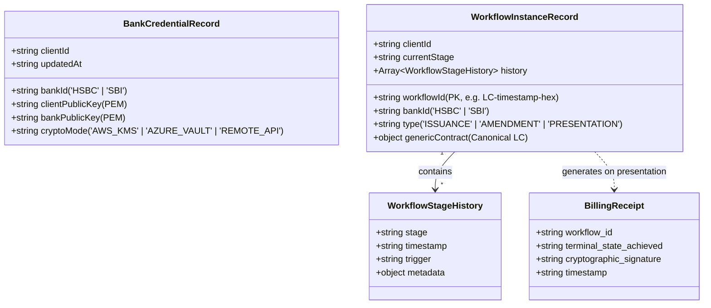
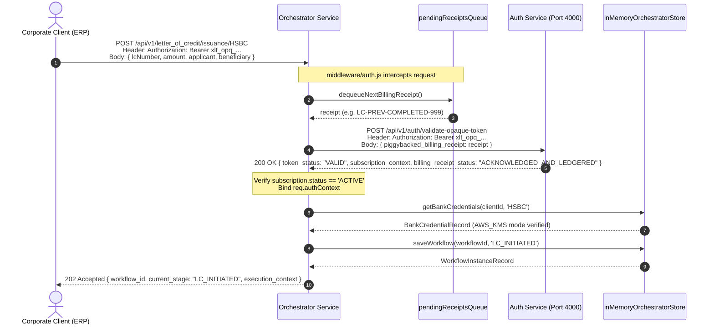
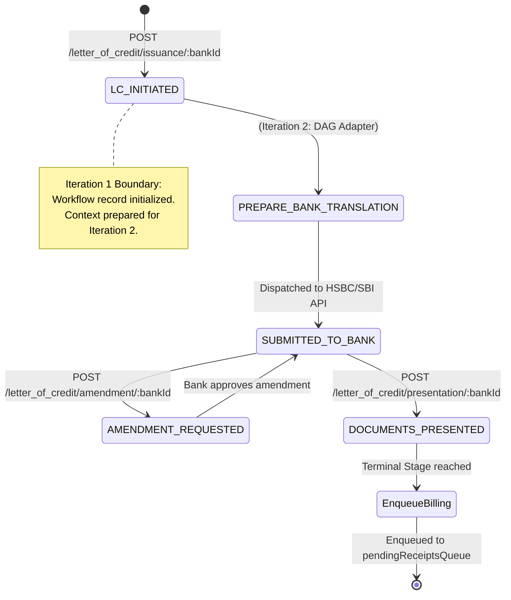

# Multi-Bank Orchestrator Service — System Design (Iteration 1)

> **Document Type**: Low-Level Design (LLD), Architectural Decisions, Trade-Offs & Interview Deep-Dive  
> **Service**: `orchestrator-service` (Port 3000)  
> **Iteration Scope**: **Iteration 1 — Baseline Multi-Bank Gateway & LC State Machine**  
> *(Bank-specific DAG adapter execution and external bank protocol dispatching are scheduled for Iteration 2).*

---

## 1. System Overview & Problem Statement

In corporate banking and global supply chains, multinational enterprises (e.g., Tata Steel) conduct cross-border commerce using **Letters of Credit (LC)**. An LC is a financial contract issued by a bank guaranteeing that a seller will receive payment once specific trade documents are presented.

Different banks operate on completely disparate technical infrastructure:
- **HSBC**: Relies on SWIFT MT700/MT707 formats, ISO 20022 XML standards (`pain.001`, `camt.053`), and dedicated secure file transfer protocols.
- **SBI (State Bank of India)**: Exposes proprietary trade finance REST APIs with custom payload structures.

### The Problem Solved in Iteration 1:
1. **Unified Enterprise Gateway**: Exposes a **canonical, bank-agnostic API** so corporate ERPs do not write custom code for each bank.
2. **Strict Non-Custodial Security**: Enables cryptographic signature verification and payload encryption **without ever holding corporate private keys**.
3. **Real-Time Subscription Enforcement**: Validates dynamic tenant concurrency limits (`ACTIVE_CAPACITY_LICENSING`) by performing an **intentional network hop** to the Auth Service on every inbound call.
4. **Piggybacked Billing Queue**: Drains completed workflow receipts and piggybacks them onto outbound auth requests, eliminating redundant billing network round-trips.

---

## 2. Low-Level Design (LLD)

### 2.1 Component Architecture

```mermaid
graph TD
    Client[Enterprise Client / Corporate ERP] -->|Bearer Token + Canonical LC Payload| GatewayRouter[routes/orchestrator.routes.js]

    subgraph Orchestrator Service Boundary (Port 3000)
        GatewayRouter --> AuthMiddleware[middleware/auth.js]
        
        AuthMiddleware -->|1. Dequeue next completed receipt| QueueBuffer[("pendingReceiptsQueue []")]
        AuthMiddleware -->|2. Route Guards: bankId in HSBC, SBI| GatewayController[controllers/orchestratorController.js]

        subgraph In-Memory Storage: inMemoryOrchestratorStore.js
            CredentialsMap[("bankCredentials Map<String, BankCredentialRecord>")]
            WorkflowsMap[("workflows Map<String, WorkflowInstanceRecord>")]
            QueueBuffer
        end

        GatewayController -->|Read/Write Public Keys| CredentialsMap
        GatewayController -->|State Transitions| WorkflowsMap
        GatewayController -->|Enqueue on Terminal Stage| QueueBuffer
    end

    subgraph Auth Service Boundary (Port 4000)
        AuthValidateAPI["POST /api/v1/auth/validate-opaque-token"]
    end

    AuthMiddleware -->|Intentional Auth Hop + Piggybacked Receipt| AuthValidateAPI
```

---

### 2.2 In-Memory Data Models & Schemas

The storage layer (`inMemoryOrchestratorStore.js`) implements $O(1)$ operations using JavaScript `Map` collections:



#### Detailed Entity Specifications:

1. **`bankCredentials: Map<String, BankCredentialRecord>`**
   - **Key**: `${clientId}:${bankId}` (e.g. `'tata_steel:HSBC'`).
   - **Non-Custodial Invariant**: `privateKey`, `secretKey`, or `clientPrivateKey` attributes are strictly rejected.
   - **`cryptoMode`**: Declares how private key signing is performed on the client's side (`AWS_KMS`, `AZURE_VAULT`, or `REMOTE_API`).

2. **`workflows: Map<String, WorkflowInstanceRecord>`**
   - **Key**: `workflowId` (Format: `LC-${Date.now()}-${randomHex}`).
   - **`currentStage`**: Tracks progression: `LC_INITIATED` $\to$ `AMENDMENT_REQUESTED` $\to$ `DOCUMENTS_PRESENTED`.
   - **`history`**: Complete immutable audit trail capturing stage changes, timestamps, and trigger metadata.

3. **`pendingReceiptsQueue: Array<BillingReceipt>`**
   - In-memory FIFO queue of completed workflow receipts waiting to be piggybacked on the next outbound authentication hop.

---

### 2.3 Core Execution Flow & Sequence Diagrams

#### Flow A: Inbound Request with the Intentional Auth Hop & Piggybacked Billing


#### Flow B: Letter of Credit State Machine (Lifecycle Transitions)


---

## 3. Key Architectural Decisions & Rationale

### Decision 1: The Intentional Network Hop on Every Request
- **Decision**: Orchestrator never verifies tokens locally using a cached copy or JWT secret. Every inbound call triggers an HTTP call to `http://localhost:4000/api/v1/auth/validate-opaque-token`.
- **Rationale**:
  1. **Active Capacity Licensing**: Enterprise pricing is based on active concurrent workflows (`maxConcurrentWorkflows` vs. `activeWorkflows`). Checking with the Auth Service guarantees the client has not exceeded their concurrent quota cluster-wide.
  2. **Instant Kill Switch**: High-value trade transactions cannot risk a 5-minute cache window if a corporate session is revoked or compromised.

### Decision 2: Zero Private Key Custody (Non-Custodial Architecture)
- **Decision**: Corporate private keys are **never stored** in the Orchestrator. The upload endpoint strictly rejects payloads containing `privateKey` or `secretKey`.
- **Rationale**:
  - Holding private keys makes the orchestrator a prime target for attackers and subjects the platform to strict custodial banking audits (PCI-DSS Level 1, SOC-2 Type II).
  - The orchestrator holds the **client public key** (to verify client signatures) and the **bank public key** (to encrypt bank dispatches).
  - Private key signing is delegated to the client's own key management system via `cryptoMode` (`AWS_KMS`, `AZURE_VAULT`, or `REMOTE_API`).

### Decision 3: Canonical Generic LC Contract vs. Bank-Specific Schemas
- **Decision**: The client submits a uniform generic JSON contract (`genericContract`). The orchestrator isolates bank-specific quirks (SWIFT MT700 for HSBC, custom JSON for SBI) inside future DAG adapters.
- **Rationale**:
  - Shields corporate clients from vendor lock-in.
  - Adding a third bank (e.g. Citi or Standard Chartered) requires only a new DAG adapter without changing the client-facing API.

### Decision 4: Asynchronous Processing (HTTP 202 Accepted)
- **Decision**: LC issuance, amendment, and presentation return `202 Accepted` rather than `200 OK`.
- **Rationale**:
  - Bank trade finance workflows involve human review at bank branches, compliance screening (OFAC/sanctions), and SWIFT transmission taking hours or days.
  - A synchronous `200 OK` would cause HTTP client timeouts. `202 Accepted` provides a `workflow_id` for tracking.

### Decision 5: Piggybacked Billing Queue Drain
- **Decision**: Orchestrator stores completed workflow receipts in `pendingReceiptsQueue` and sends them attached to the *next* token validation call.
- **Rationale**:
  - Amortizes network round-trips: merges authorization and billing acknowledgment into a single HTTP hop ($O(N)$ network calls instead of $O(2N)$).

---

## 4. In-Depth Trade-Off Analysis

| Dimension | Our Design (Iteration 1) | Alternative Approach | Trade-Off Rationale |
| :--- | :--- | :--- | :--- |
| **Auth Verification** | **Intentional Network Hop** | Stateless JWT signature verification | **Pros**: Real-time revocation & capacity quota check.<br>**Cons**: Adds 3–8ms latency per request. Worth it for multi-million dollar LC security. |
| **Key Custody** | **Non-Custodial (Public Keys Only)** | Custodial (KMS-backed private key store) | **Pros**: Zero liability for key compromise; corporate keys never leave client perimeter.<br>**Cons**: Requires client to expose an KMS endpoint for signing. |
| **Billing Delivery** | **Piggybacked on Auth Hop** | Dedicated Kafka / RabbitMQ producer | **Pros**: No distributed message broker required; zero network overhead.<br>**Cons**: Billing delivery depends on subsequent traffic (or requires a background flush timer). |
| **Bank Selection** | **Strict Route Guard (`HSBC`, `SBI`)** | Dynamic Plugin / SPI Engine | **Pros**: Highly deterministic, simple code structure for interview recall.<br>**Cons**: Adding new banks requires code edits instead of dynamic configuration. |
| **State Storage** | **In-Memory JavaScript Maps** | PostgreSQL / Redis / DynamoDB | **Pros**: Zero external dependencies; instant setup for interview demos; $O(1)$ lookups.<br>**Cons**: Ephemeral state; restarts wipe data. |

---

## 5. Interview Deep-Dive: Questions That Could Be Asked

### Q1: "Why do you have an intentional network hop to Auth Service on every request? Isn't that an anti-pattern?"
> **Candidate Answer**:
> *"In consumer microservices, caching JWTs locally is common to avoid network hops. However, in **corporate banking and trade finance**, this network hop is deliberate for two reasons:
> 1. **Immediate Revocation**: Transactions involve millions of dollars; we cannot afford a 5-minute window where a compromised or revoked corporate session executes an LC.
> 2. **Active Capacity Licensing**: Enterprise licensing is based on concurrent workflow execution quotas (`maxConcurrentWorkflows`). The Auth Service acts as the authoritative central authority that tracks whether the client has quota available cluster-wide before the orchestrator allocates resources."*

---

### Q2: "How does the Orchestrator sign transactions if it never stores the corporate private key?"
> **Candidate Answer**:
> *"We follow a **non-custodial cryptographic boundary**. Our storage layer explicitly rejects any payload containing private keys. 
> We store only the **client public key** (to verify incoming client signatures) and the **bank public key** (to encrypt outbound messages). 
> For private key signing, our `BankCredentialRecord` stores a `cryptoMode` (`AWS_KMS`, `AZURE_VAULT`, or `REMOTE_API`). When the orchestrator needs a payload signed, it dispatches an asymmetric sign request to the client's own KMS or HSM. The private key never leaves the client's corporate boundary, drastically reducing our SOC-2 and regulatory audit scope."*

---

### Q3: "What happens if the Auth Service is down when a client calls the Orchestrator?"
> **Candidate Answer**:
> *"In `middleware/auth.js`, if the network hop fails (network error, timeout, or HTTP 5xx):
> 1. The middleware catches the exception and returns **`503 Service Unavailable`** with `{ error: 'auth_unavailable' }`.
> 2. **Fault Tolerance for Piggybacked Billing**: If a pending billing receipt was dequeued for that hop, the catch block immediately **re-enqueues the receipt** back to `pendingReceiptsQueue` so that no billing data is permanently lost. The receipt will be retried on the next incoming request."*

---

### Q4: "Why return HTTP 202 Accepted instead of 200 OK for LC Issuance?"
> **Candidate Answer**:
> *"Trade finance workflows are inherently asynchronous. Generating a Letter of Credit with a bank involves multi-party approvals, sanction screening, SWIFT MT700 encoding, and bank branch authorization—a process that takes hours or days. 
> Returning `202 Accepted` immediately confirms that the request was syntactically valid and accepted for processing, and gives the client a durable `workflow_id` to poll or subscribe to via webhooks without holding open an HTTP connection."*

---

### Q5: "How does the Piggybacked Billing Queue work, and what is its edge case?"
> **Candidate Answer**:
> *"When a workflow reaches a terminal stage (like `DOCUMENTS_PRESENTED`), we generate a cryptographically signed `BillingReceipt` and push it to `pendingReceiptsQueue`. 
> When any subsequent API call comes in from a client, `middleware/auth.js` dequeues the receipt and sends it as `piggybacked_billing_receipt` in the body of the auth validation request. The Auth Service validates the session and ledgers the receipt in a single round-trip.
> **Edge Case**: If no client requests come in for a long time, receipts sit in the queue. In a production system, we would complement piggybacking with a lightweight **background flush timer** (e.g. every 60 seconds) to drain lingering receipts if traffic is idle."*

---

### Q6: "How would you scale this prototype from In-Memory Maps to a high-availability production system?"
> **Candidate Answer**:
> *"To scale to production:
> 1. **Persistent State Store**: Replace the in-memory `workflows` Map with a distributed document store (MongoDB / DynamoDB / PostgreSQL JSONB) with optimistic locking on `currentStage`.
> 2. **Workflow Orchestration**: Replace the in-memory state transitions with a durable workflow engine like **Temporal.io** or **AWS Step Functions**, which handles timeouts, retries, and compensation logic (Saga pattern) across banks.
> 3. **Billing Ingestion**: Keep the piggybacking mechanism, but have Auth Service push receipts directly into **Apache Kafka** for async aggregation by billing worker microservices.
> 4. **Credentials Vault**: Store public key records and KMS ARN references in **HashiCorp Vault** with strict role-based access control."*

---

### Q7: "What is the time complexity of the operations in Iteration 1?"
> **Candidate Answer**:
> - **Credential Lookup (`getBankCredentials`)**: $O(1)$ HashMap lookup by `${clientId}:${bankId}`.
> - **Workflow Lookup / Update (`getWorkflow`, `saveWorkflow`)**: $O(1)$ HashMap operation by `workflowId`.
> - **Receipt Dequeue (`dequeueNextBillingReceipt`)**: $O(1)$ amortized array shift operation.
> All local gateway operations are instantaneous with zero I/O blocking.
